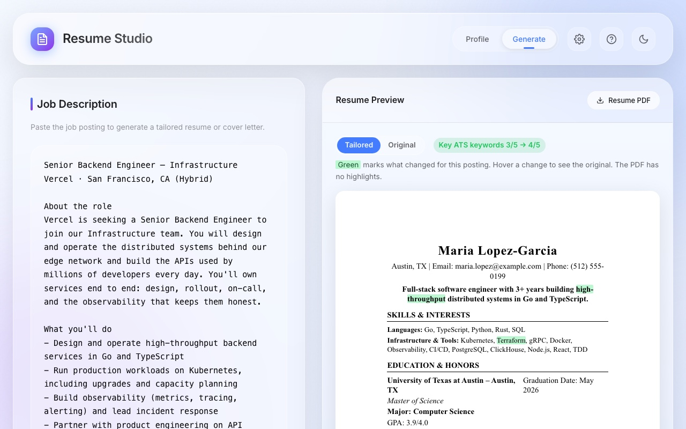
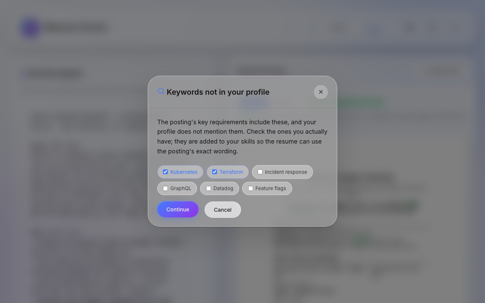

# Resume Studio

Resume Studio is a Manifest V3 Chrome extension that tailors the user's own resume to a job posting and writes a matching cover letter. It runs entirely in the browser and calls the OpenAI API directly with the user's own key. There is no backend: the profile, the uploaded resume and generated documents stay in the extension's local storage, and the generation code lives in plain ES modules inside the extension.

**Stack:** JavaScript, Chrome Extensions (MV3), OpenAI API, pdf.js, jsPDF, node:test



## How it works

### Profile and baseline

The user uploads their existing resume as a PDF. `resumeParser.js` reads it in the browser with pdf.js and heuristics: text positions, font size and weight, and a dictionary of section headings. There is no model call. The parsed result does two things:

- It is merged into the profile additively. New items are appended, matching items have their blanks filled in, and nothing the user entered is overwritten.
- It is frozen as the **baseline**, a snapshot of the uploaded resume that every tailored resume starts from. Only a new upload replaces it, and profile edits never change it.

### Generation pipeline

The pipeline is in `extension/generation/`, orchestrated by `pipeline.js`. Every model call goes through a small fetch wrapper (`openai.js`, no SDK), and every generation call asks for strict JSON-schema output. The model, the reasoning effort per call and the research limits are pinned in `config.js`.

1. **Match analysis** (`matchAnalysis.js`). The posting is read against the profile, which is given to the model with stable ids (`exp:3`, `proj:5`, `skill:Go`). The result lists the company, the role, every requirement with the profile items that support it (strong, partial or none) and the posting's ATS keywords, each marked core or supporting.

2. **Keyword check** (`keywords.js`). Core keywords that appear nowhere in the profile, at most 8, are shown to the user as checkboxes. The ones they tick are added to their profile skills before anything is written, so the profile stays the only source of material.

   

3. **Company research** (`companyResearch.js`, cover letters only, optional). This uses the Responses API with OpenAI's hosted web search, capped at 3 searches. It produces a short brief where every fact carries its source URL, or `found: false` when nothing credible turns up. Briefs are cached per company for 30 days.

4. **Resume: a validated edit list** (`tailor.js`, `layout.js`). The model never writes a resume from scratch. It sees the baseline with an id on every line, plus a "pool" of profile material that isn't on the resume, and returns a list of edits:
   - `rewrite`: reword a summary, bullet or coursework line, for example to use the posting's terms
   - `swap`: replace a bullet with an unused bullet from the same job or project, or a project or extra with an unused one
   - `skills`: reorder a skill line or add profile skills to it
   - `remove`: drop a bullet, project, extra or coursework line, used only to fit the page

   `validateEdits()` checks every edit in code. Jobs, education and headings can't be edited. A rewrite can't add a number that isn't in the original line, can't drop a named term from it, and can't grow past about 1.4 times its length. A skills edit must keep every existing item and can only add skills from the profile. Swaps must come from the pool, and each pool item can be used once. Rejected edits go back to the model with the reason, for up to two repair attempts. Any still invalid are dropped.

5. **Cover letter** (`coverLetter.js`). The prompt allows nothing about the candidate outside the profile and nothing about the company outside the posting or the brief. Along with the letter, the model returns a `claims` list naming the source of each factual sentence (a profile id, "job posting" or a brief URL). Claims that cite an unknown source trigger one repair attempt, and any left after that are reported to the user in the status line rather than hidden.

### One page

The one-page limit is planned before the resume is edited, not fixed afterwards. The extension renders the baseline off-screen at print size. For each kind of line it measures font, width, line height and spacing, and measures text with a canvas. The prompt gives the model the page's free space and how many characters each line has left before it wraps.

The validator adds up the height of every edit. If the result would go past one page, that becomes another error for the repair attempts. If the edits still don't fit, `fitToPage()` first undoes the edits that add the most height, then removes whole items in a fixed order: extras such as certifications and awards, then projects, then older jobs' later bullets (every job keeps at least one), then coursework. It never cuts a line in half.

Finally the extension measures the real rendered result. If that still spills over, it runs tailoring again with the measured error added to the budget, at most twice.

### Preview and export

`highlight.js` builds two versions of the tailored resume. The preview shows changes in green, with the original wording on hover, and a toggle shows the uploaded PDF for comparison. The clean version, without highlights, is what gets printed. Tailored text is HTML-escaped before rendering.

The resume PDF comes from a print view (`print.html`) through Chrome's Save as PDF, so it is a text PDF that applicant tracking systems can read. The cover letter PDF is generated with jsPDF.

## Testing

Unit tests cover the code that runs without the API: the baseline snapshot, the keyword check, edit validation and application, page fitting, line wrapping and the preview diff. They make no network calls.

```bash
node --test 'test/unit/*.test.mjs'
```

The prompt eval set in `test/eval/` runs the real pipeline in Node against 2 synthetic profiles and 5 job postings, then scores each document against a fixed rubric. For resumes the rubric checks, among other things, that jobs and education are untouched, no numbers were invented, unedited lines are identical and the page fits. For cover letters it checks length, grounding in the profile, buzzwords and invented numbers. Summaries are saved under `test/eval/baselines/` so prompt changes can be compared. A full run costs about $1 and needs an OpenAI key in `OPENAI_API_KEY` or `test/eval/.env`.

```bash
node test/eval/run.js --profiles david --jobs 02           # one profile and posting
node test/eval/run.js --label my-change --baseline         # full set, saves a summary
node test/eval/run.js --rescore test/eval/runs/<dir>       # re-score saved outputs, no API calls
```

See `test/eval/README.md` for the full rubric.

The PDF parser is checked by hand. Serve the repo root (`python3 -m http.server 8790`), open `http://localhost:8790/test/parser.html` and pick one of the synthetic resume PDFs in `test/fixtures/`.

## Install from source

1. Clone the repository: `git clone https://github.com/JohnathanCarr/resume-cv-generator.git`
2. Open `chrome://extensions` and turn on **Developer mode**.
3. Click **Load unpacked** and select the `extension/` folder, not the repository root.
4. Click the extension's toolbar icon. The app opens in its own tab and starts a short first-run tour.

After editing `app.js`, `manifest.json` or anything in `generation/`, click the reload icon on the extension's card. Changes to `app.html` or `styles.css` only need a tab refresh.

## API key setup

1. Create a key at [platform.openai.com/api-keys](https://platform.openai.com/api-keys). The account needs credits, because generation is billed to it.
2. In the extension, open Settings (the gear icon), paste the key and click **Save key**.
3. Settings shows **Verified** once a test call to OpenAI succeeds.

Once saved, the key is shown masked: it can be replaced or removed, but not viewed.

Generation is billed to that OpenAI account, and use of the API is subject to [OpenAI's usage policies](https://openai.com/policies/usage-policies). Resume Studio charges nothing. Generated documents are drafts: AI can get details wrong, so read each one before sending it. Settings repeats this under the key, and the preview shows a reminder.

## Privacy

Everything is stored in `chrome.storage.local` on the user's machine: the profile, the uploaded PDF, the API key, the last generated resume and cached company briefs. The only network host the extension can reach is `api.openai.com`, its only host permission. When generating, it sends OpenAI the job posting, the profile, the parsed text of the uploaded resume (for tailoring), and the company name and posting (for research). The PDF file itself is never uploaded. There is no analytics or tracking. The full policy is in [PRIVACY.md](PRIVACY.md).

## Troubleshooting

**The extension won't load.** Make sure Developer mode is on and that you selected the `extension/` folder rather than the repository root. Errors appear on the extension's card in `chrome://extensions`.

**The key shows an error instead of Verified.** "OpenAI rejected this key" means the key is wrong or revoked: create a new one and use **Replace key**. "Could not reach OpenAI" is a network problem; some corporate networks block `api.openai.com`.

**Generation fails.** Check that the key shows Verified and that the OpenAI account has credits and isn't rate-limited. If the model runs out of room ("The model ran out of room before finishing") the request is retried once automatically; if it still fails, run it again. The full error is in the console of the extension tab (F12).

**"Upload your current resume in the Profile tab first."** Tailoring edits your uploaded resume, so a resume needs a PDF upload; cover letters don't.

**Upload filled in little or nothing.** The parser needs a PDF with selectable text; scanned PDFs have none. Multi-column and table layouts parse poorly because their text comes out of the PDF in the wrong order. Section headings it doesn't recognise are reported in the status message and either filed under extras or skipped.

**The resume PDF has a date or URL printed on it.** In the print dialog, open **More settings** and turn off **Headers and footers**.

## File structure

```
resume-cv-generator/
├── extension/                # Load this folder in Chrome
│   ├── manifest.json         # MV3 manifest: storage, unlimitedStorage, downloads, api.openai.com
│   ├── app.html, app.js      # App UI, storage, page measurement, PDF export
│   ├── styles.css
│   ├── background.js         # Opens or focuses the app tab
│   ├── onboarding.js         # First-run tour
│   ├── theme.js              # Light/dark theme
│   ├── resumeParser.js       # PDF → profile, heuristic, no model call
│   ├── profileMerge.js       # Additive profile merge
│   ├── print.html, print.js  # Resume print view (Save as PDF)
│   ├── generation/           # Pipeline, prompts, validators, layout model, OpenAI client
│   ├── icons/
│   └── jspdf.min.js, pdf.min.js, pdf.worker.min.js   # Bundled libraries
├── test/
│   ├── unit/                 # node:test unit tests
│   ├── eval/                 # Prompt eval set: profiles, postings, rubric, baselines
│   ├── fixtures/             # Synthetic resume PDFs and their HTML sources
│   └── parser.html           # Parser test page
├── store/                    # Chrome Web Store listing copy, icon source, screenshots
├── scripts/                  # package.sh (store zip), screenshots.sh
├── LICENSE
├── PRIVACY.md
├── QUICK_START.md
└── CLAUDE.md                 # Architecture notes for contributors
```

## License

[MIT](LICENSE). The bundled libraries keep their own licenses: pdf.js (Apache 2.0) and jsPDF (MIT), with notices at the top of each file in `extension/`. Use of the OpenAI API is subject to [OpenAI's usage policies](https://openai.com/policies/usage-policies).
